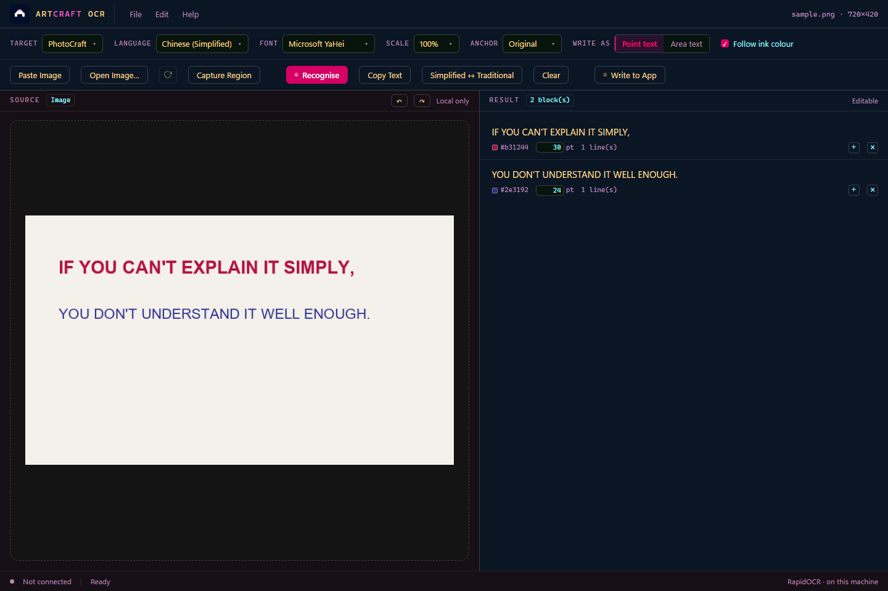
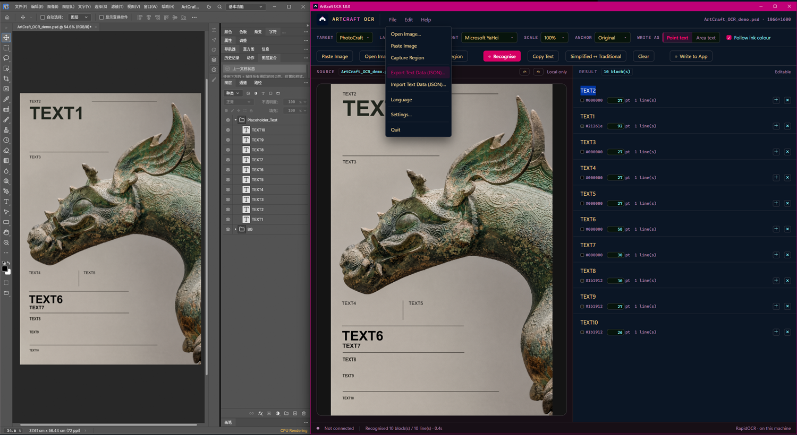
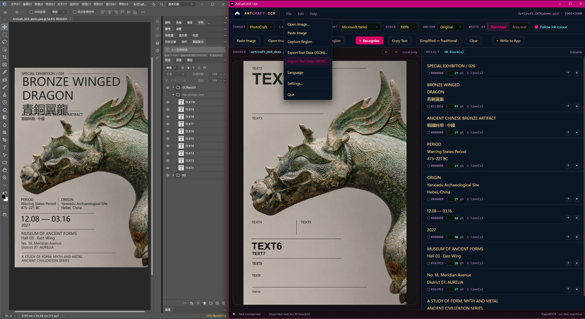
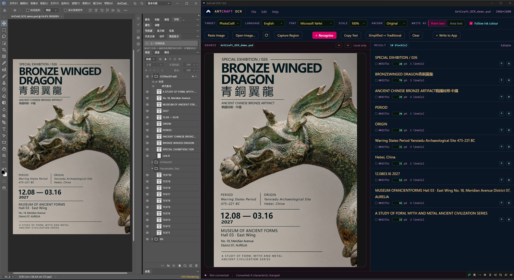
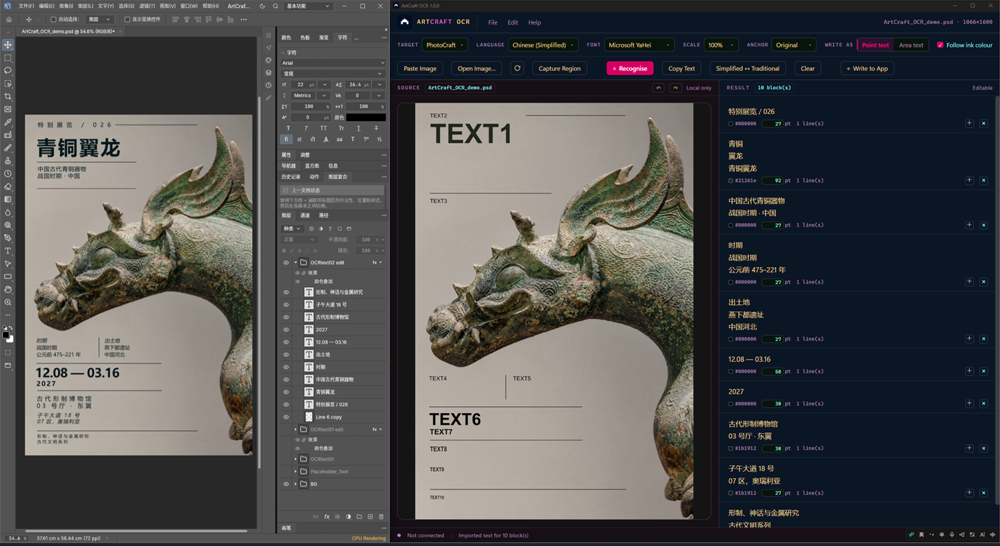
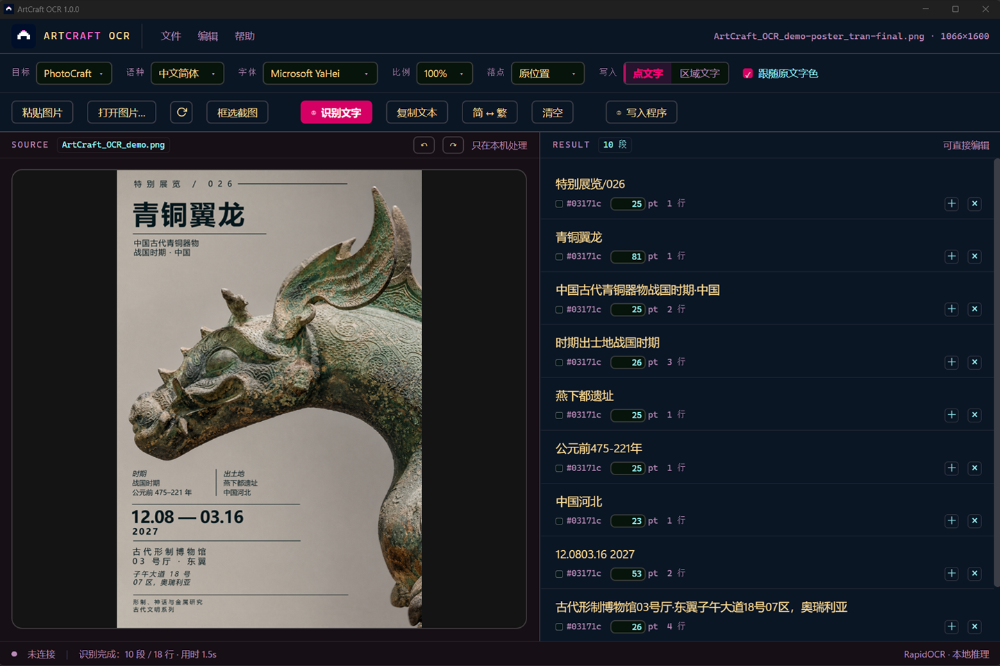

# ArtCraft OCR

**Local text recognition for ArtCraft.** Read text from an image, fix it in a plain editable
list, then place it into your document as real text layers. All OCR processing runs locally: no
account, no cloud upload, no internet connection required.



**[中文说明](README.zh-CN.md)**

## What it does

- **Recognise** Simplified Chinese, Traditional Chinese and English from a screenshot, a pasted
  image, or a region you drag on screen.
- **Edit** the result as ordinary text before anything is written: a blank line starts a new
  block, `+` and `×` add and remove blocks, colour and size are editable per block, undo and redo
  with up to ten history steps.
- **Write** it into PhotoCraft as real text layers — one layer per line, or one text frame per
  block, placed at the position and size the original had.
- **Refresh** re-reads the picture from disk. PSD can be opened directly — what you see is the
  file's flattened preview, not its individual layers — so the design can keep changing in
  PhotoCraft while you recognise from the current state.
- **Convert** Simplified ↔ Traditional Chinese text locally, one button, no network.
- **Export / import** the whole result as JSON (`artcraft.ocr.textdata/1`): export it, translate
  or rewrite it with the AI or script you prefer — a chat model, a script, a colleague — import it
  back, and the text lands in the same frames.

## Walkthrough

A poster laid out with placeholder text, and the whole loop on one screen. PhotoCraft on the left,
ArtCraft OCR on the right.

| | |
|---|---|
|  | **1 · Recognise.** Ten placeholders become ten blocks — each with the position it occupied, the size its type implies, its ink colour, and a paragraph of its own. Nothing is guessed from "what the text says". |
|  | **2 · Replace the text.** Type in the blocks, or export the JSON, translate or rewrite it anywhere, and import it back. Area text goes in as one frame per block. |
|  | **3 · Written to PhotoCraft.** Each block lands as real text in a group (`OCRtext01`), on the position and at the size the original had. From there it is an ordinary document — spacing, weights and typography are yours to finish. |
|  | **4 · The same loop in Chinese.** Placeholders recognised, replaced with Chinese, written back and finished by hand. |


## Requirements

- Windows 10 or 11, 64-bit.
- WebView2 runtime. Windows 11 has it; on Windows 10 the Evergreen runtime from Microsoft is
  needed (most machines already have it with Edge).
- PhotoCraft, for the write step. Reading, editing and exporting work without it.

No Python installation is required — the interpreter is inside the package.

## Install

1. Download `ArtCraftOCR-1.0.0-win64.zip` from the Releases page (101.8 MB).
2. Extract it anywhere. Keep the folder: the program is a folder, not a single file.
3. Run `ArtCraftOCR.exe`.

The build is not code-signed, so Windows SmartScreen shows "Windows protected your PC" the first
time. Choose **More info → Run anyway**. That is expected for an unsigned build, and it is why the
source is here.

## First run

1. **File → Settings…**
2. Click **Choose photocraft.exe…** and pick `photocraft.exe`.
3. Click **Create photocraft_OCR.bat in the program folder**. Optionally tick **Create a desktop
   shortcut**.
4. Start PhotoCraft with that bat (or the shortcut it made), then come back.

The bat is not an extra installation step. It starts PhotoCraft with its **external control
channel** open, which is how this program places layers into your document; a copy started by
double-clicking `photocraft.exe` opens no channel, so nothing can write to it.

## Use

| Step | What happens |
|---|---|
| 1. Get a picture | **Paste Image**, **Open Image…** (PNG, JPEG, WebP, BMP, TIFF, **PSD**), or **Capture Region** |
| 2. **Recognise** | Text appears on the right, one block per paragraph, with the colour and size taken from the picture |
| 3. Edit | Type, paste as plain text, split with a blank line, `+` / `×` per block, undo/redo above the image |
| 4. Choose | **Point text** (one layer per line) or **Area text** (one frame per block) |
| 5. **Write to App** | The blocks land in PhotoCraft, grouped as `OCRtext01`, `OCRtext02`, … |

**Simplified ↔ Traditional** is one button that alternates direction on each press. For
translation, use the JSON round trip: export, translate anywhere, import.

> **Before you capture the PhotoCraft window, set the view to 100 %.** At 100 % the screenshot's
> pixels are the document's pixels, so position and size come out right. At any other zoom the
> picture is scaled, and every size written back is off by that factor — nothing on this side can
> correct it.

## Languages

Recognition: Simplified Chinese, Traditional Chinese, English.

Interface: English and Chinese. **English is the default**, and the switch is **File → Language**;
the choice is saved in `settings.json` next to the executable.



## Privacy

Recognition, conversion and export all run in-process. The program makes no network requests and
ships no telemetry. The only files it writes are `settings.json` (your settings), `control.token`
(so it can talk to PhotoCraft), and — if you ask for it — the launch script and a desktop shortcut.

## Known limits

- Short text (one or two characters) on a large image can be missed; cropping tight usually
  recovers it.
- Sizes assume the host document is at 100 % zoom.
- The window position is decided by the platform.
- PhotoCraft is the only host with an adapter so far. **FilmCraft and VectorCraft: coming soon.**

## Build from source

```
python -m pip install -r PACKAGING/requirements.txt
python PACKAGING/build.py --check-only     # tests only
python PACKAGING/build.py                  # tests, then package
```

`build.py` runs the unit tests, the interface check and an import check of the shell; if any of
them fails it does not package. The output lands in `PACKAGING/out/ArtCraftOCR/`.

## Licence

**ArtCraft OCR's own source code** is licensed under the **Apache License 2.0** — see
[LICENSE](LICENSE) and [NOTICE](NOTICE).

Third-party components shipped with it (onnxruntime, OpenCV, Pillow, RapidOCR, pywebview and
others) and the OCR model weights keep **their own licences**; their texts are in
[THIRD-PARTY/](THIRD-PARTY/), and the audit behind that folder is in
[DOCS/LICENSES.md](DOCS/LICENSES.md). This project's licence does not relicense them.

"ArtCraft", "PhotoCraft", "FilmCraft" and "VectorCraft" are trademarks of **their respective
owners**. This project is an **independent tool: it is not affiliated with, endorsed by, or
sponsored by** the ArtCraft project. The Lp2 mark and the visual identity assets are trademarks
of Laplace2-ai. The licences above cover code and data, not names or logos.
