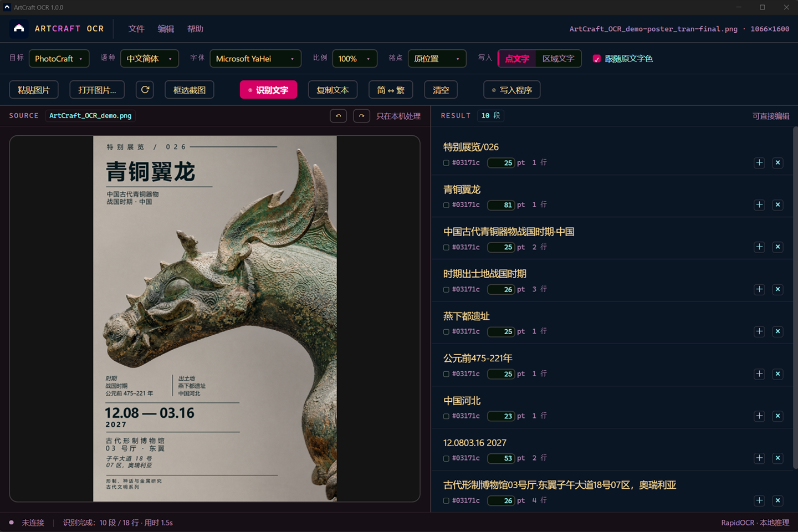
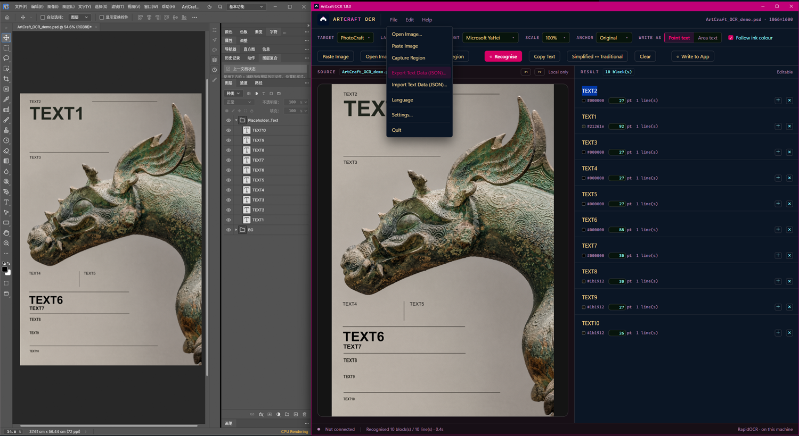
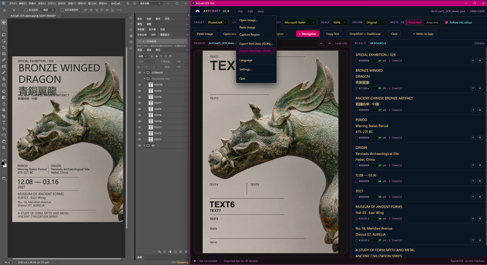
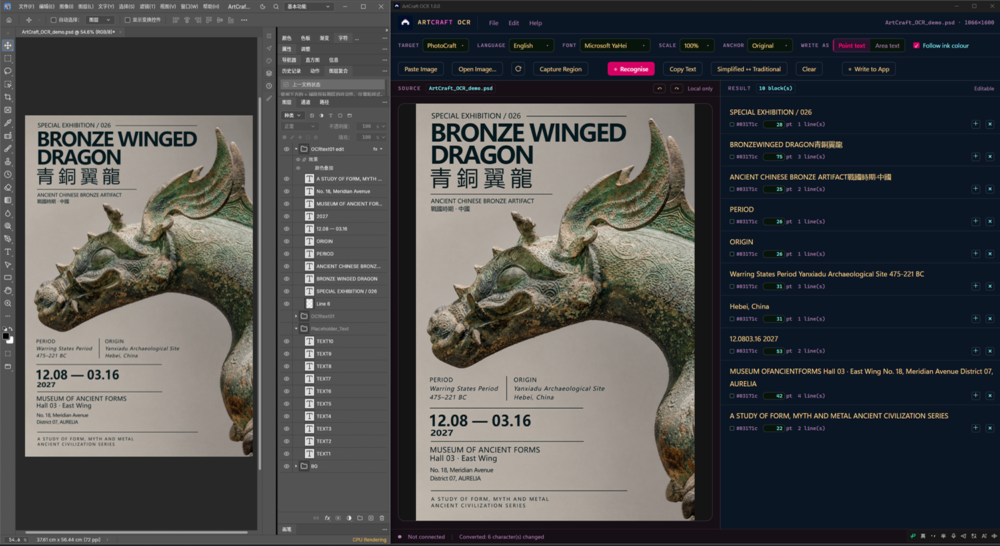
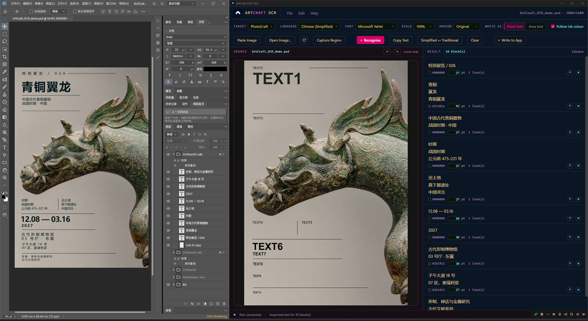

# ArtCraft OCR

**给 ArtCraft 用的本地文字识别工具。** 从图片里读出文字，在可编辑的列表里改好，再作为真正的
文字图层写进你的文档。全程在本机完成——不需要账号，不上传，不联网。



**[English](README.md)**

## 能做什么

- **识别**：中文简体、中文繁体、英文。来源可以是截图、粘贴的图片，或在屏幕上拖框选取的区域。
- **修改**：识别结果是普通文本，写进去之前随便改。空行分一段，`+` / `×` 加减段落，每段的颜色和
  字号可以单独调；撤销/重做最多十步。
- **写入**：写进 PhotoCraft 变成真正的文字图层——点文字一行一层，区域文字一段一个文本框，位置和
  字号按原图来。
- **刷新**：从磁盘重新读一次图。PSD 可以直接打开，但读到的是这个文件的**合并预览图**，不是
  PSD 内部的一个个图层；所以可以一边在 PhotoCraft 改，一边在这里按当前状态识别。
- **中文字形转换（简 ↔ 繁）**：本地，一键，不联网。
- **导出 / 导入**：整份结果导出 JSON（`artcraft.ocr.textdata/1`），用你习惯的 AI 或脚本翻译、
  改写，再导入回来，文字落回原来的框。

## 使用演示

一张用占位文字排好的海报，整个流程在一屏里。左边 PhotoCraft，右边 ArtCraft OCR。

| | |
|---|---|
|  | **① 识别**：十个占位文字变成十个块，每块带着它原来的位置、字号、原文字色，并且各自独立成段。判断依据是版面，不是"文字写的是什么"。 |
|  | **② 换掉文字**：在框里直接改，或者导出 JSON、拿到别处翻译/重写、再导入回来。区域文字一段一个框。 |
|  | **③ 写进 PhotoCraft**：每块都变成真正的文字图层，归在一组（`OCRtext01`），位置和字号按原图。之后它就是普通文档——字距、字重、排版都归你调。 |
|  | **④ 同样的流程，中文版**：识别占位、替换成中文、写回、手工收尾。 |


## 运行要求

- Windows 10 / 11，64 位。
- WebView2 运行时。Windows 11 自带；Windows 10 需要微软的 Evergreen 运行时（装了 Edge 的机器
  通常已有）。
- PhotoCraft：只有"写入"这一步需要。识别、修改、导出不需要它。

**不需要安装 Python**，解释器在压缩包里。

## 安装

1. 到 Releases 页下载 `ArtCraftOCR-1.0.0-win64.zip`（101.8MB）。
2. 解压到任意位置。**整个文件夹都要留着**——程序是一个文件夹，不是一个单独的文件。
3. 双击 `ArtCraftOCR.exe`。

这个构建没有代码签名，首次运行 Windows 会弹"Windows 已保护你的电脑"。点 **更多信息 → 仍要运行**。
未签名构建都是这样，源码放在这里也是这个原因。

## 首次使用

1. **文件 → 设置…**
2. 点 **选择 photocraft.exe…**，选中 `photocraft.exe`。
3. 点 **在程序目录生成 photocraft_OCR.bat**。需要的话勾上 **创建桌面快捷方式**。
4. 用这个 bat（或它创建的快捷方式）启动 PhotoCraft，再回到本程序。

这个 bat 不是额外的安装步骤：它启动 PhotoCraft 时**打开外部控制通道**，本程序正是通过这个通道
把文字图层放进你的文档。直接双击 `photocraft.exe` 打开的那份不会开这个通道，所以什么都写不进去。

## 使用流程

| 步骤 | 发生什么 |
|---|---|
| ① 放图 | **粘贴图片** / **打开图片…**（PNG、JPEG、WebP、BMP、TIFF、**PSD**）/ **框选截图** |
| ② **识别文字** | 右侧出现文字，一段一块，颜色和字号取自原图 |
| ③ 改 | 直接打字、粘贴为纯文本、空行分段、每段 `+` / `×`、图上方的撤销/重做 |
| ④ 选 | **点文字**（一行一层）或 **区域文字**（一段一框） |
| ⑤ **写入程序** | 写进 PhotoCraft，自动归到一个组 `OCRtext01`、`OCRtext02`… |

**简繁体**用一个 `简 ↔ 繁` 按钮来回切。翻译请走 JSON 往返：导出 → 别处翻 → 导入。

文档在 **100% 缩放**时，写进去的字号与原图一致。其他缩放比例下，截图的像素不等于文档的像素，
字号会按比例偏大或偏小——这一侧无法修正，截图前请把文档调到 100%。

## 语言

识别：中文简体、中文繁体、英文。

界面：英文与中文。**默认英文**（看不懂中文的人找不到切换入口），切换在 **File → Language**；
选择会存进 exe 旁边的 `settings.json`。

## 隐私

识别、繁简转换、导出全部在本进程内完成。程序不发网络请求、不带遥测。它只写这些文件：

- `settings.json`：你的设置
- `control.token`：与 PhotoCraft 通信用的令牌
- `photocraft_OCR.bat` 和桌面快捷方式：只有你点按钮才会生成

## 已知限制

- 大图上的短文本（一两个字）可能识别不出；把图裁紧一些通常可以救回来。
- 字号假定目标文档在 100% 缩放。
- 窗口位置由系统决定。
- 目前只有 PhotoCraft 有适配器，FilmCraft、VectorCraft 在计划中。

## 从源码构建

```
python -m pip install -r PACKAGING/requirements.txt
python PACKAGING/build.py --check-only     # 只跑测试
python PACKAGING/build.py                  # 测试通过后打包
```

`build.py` 会先跑单测、界面检查、外壳导入检查，任何一项不过就不出包。产物在
`PACKAGING/out/ArtCraftOCR/`。

## 许可

**ArtCraft OCR 自有源码**采用 **Apache License 2.0** —— 见 [LICENSE](LICENSE) 与
[NOTICE](NOTICE)。

随包分发的第三方组件（onnxruntime、OpenCV、Pillow、RapidOCR、pywebview 等）以及 OCR 模型权重，
**各自保留原有许可**；许可原文都在 [THIRD-PARTY/](THIRD-PARTY/)，审计过程见
[DOCS/LICENSES.md](DOCS/LICENSES.md)。本项目自己的许可不改变它们的许可。

"ArtCraft"、"PhotoCraft"、"FilmCraft"、"VectorCraft" 是**各自权利人**的商标。本项目是
**独立工具：与 ArtCraft 项目没有隶属关系，也未获得其授权或背书**。Lp2 标志与视觉识别资产是
Laplace2-ai 的商标。上面的许可覆盖代码与数据，不覆盖名称与标志。
