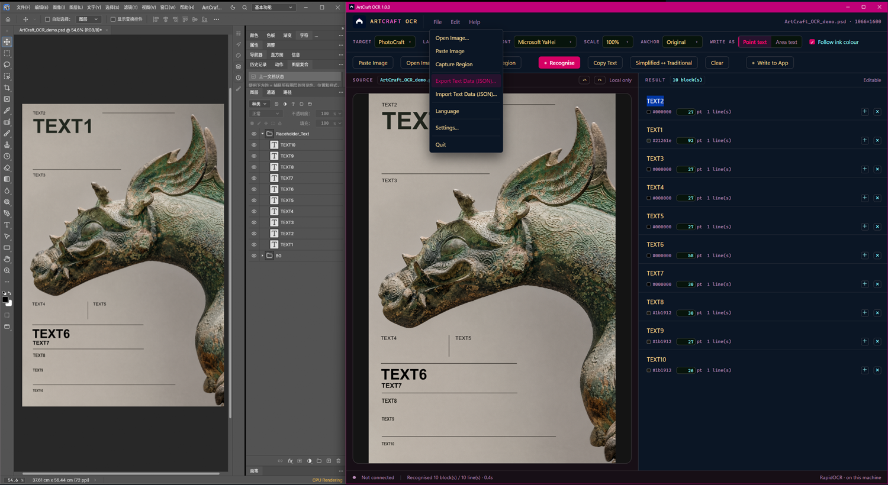
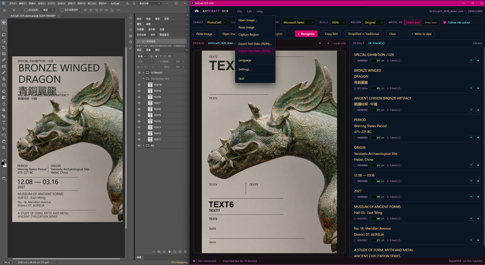
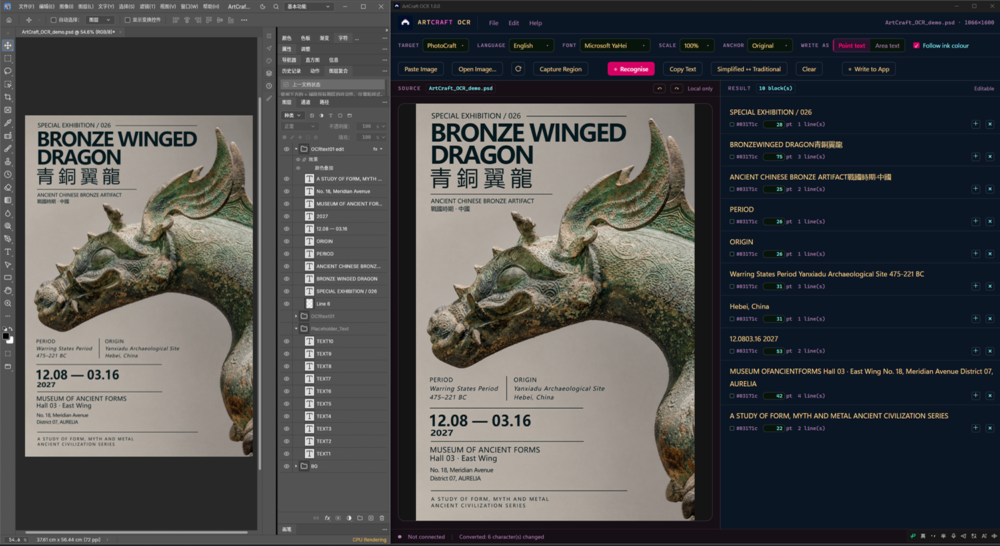
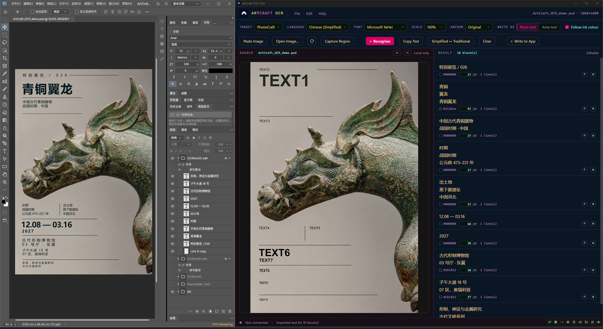

# Release page draft — ArtCraft OCR 1.0.0

For the GitHub **Releases → Create a new release** body. English first, Chinese after the rule.
Image URLs point at `main` and only resolve once the repository is public and pushed — paste
them as-is.

---

## ArtCraft OCR 1.0.0

Read the text out of a picture and put it back as real text layers — positioned where the
original was, at the size and colour it had. All OCR processing runs locally: no account, no
cloud upload, no internet connection required.

**Download:** `ArtCraftOCR-1.0.0-win64.zip` (103.1 MB) · Windows 10/11, 64-bit · SHA-256 in
`SHA256SUMS.txt`

### What it does

- **Recognise** Simplified Chinese, Traditional Chinese and English, locally (RapidOCR on
  onnxruntime).
- **Keep the layout data**: a box, a size implied by the type, and the ink colour of every line.
- **Edit before writing**: type in the blocks, split with a blank line, `+` / `×` per block,
  colour and size per block, undo and redo with up to ten history steps.
- **Two ways to write**: *point text* — one layer per line, on the original position and size;
  *area text* — one text frame per block, sized from the text as edited.
- **Import / export JSON** (`artcraft.ocr.textdata/1`): for translation or rewriting, export the
  text data, edit it with the AI or script you prefer, then import it back and write.
- **Simplified ↔ Traditional Chinese text conversion**, one button that alternates direction,
  local and instant.

### The loop

|  |  |
|---|---|
| **Edit or import** — the text is plain text until you write it | **Written to PhotoCraft** as a group (`OCRtext01`), ready for typography |

### First run

1. **File → Settings…** → **Choose photocraft.exe…**
2. **Create photocraft_OCR.bat in the program folder**
3. Start PhotoCraft with that bat, then write from here.

The bat is not an extra installation step. It starts PhotoCraft with its **external control
channel** open — that channel is how this program places layers into your document. A copy started
by double-clicking `photocraft.exe` does not open one, so nothing can write to it.

PSD files can be opened directly: the picture shown is the file's **flattened preview**, not its
individual layers. **Refresh** re-reads the file, so you can keep working in PhotoCraft and
recognise from the current state.

### Unsigned build

No code-signing certificate, so SmartScreen shows "Windows protected your PC" on first run:
**More info → Run anyway**. The source for this build is in this repository.

### Known limits

- Short text (one or two characters) on a large image can be missed; crop tighter to recover it.
- Sizes assume the document is at 100 % zoom. At other zoom levels the screenshot's pixels are
  not the document's pixels.
- PhotoCraft is the only host with an adapter so far. FilmCraft and VectorCraft are planned.
- Paragraph frame width is measured in the font you choose in the toolbar; if the document uses a
  different font, the width will be off by that difference.

### Notices

**ArtCraft OCR's own source** is Apache License 2.0 (`LICENSE`). Third-party components shipped
with it (onnxruntime, OpenCV, Pillow, RapidOCR, pywebview and others) and the OCR model weights
keep **their own licences** — each text is in `THIRD-PARTY/`. This project's licence does not
relicense them.

"ArtCraft", "PhotoCraft", "FilmCraft" and "VectorCraft" are trademarks of their respective owners.
This is an independent tool, not affiliated with, endorsed by, or sponsored by the ArtCraft
project; the Lp2 mark belongs to Laplace2-ai.

---
---

## ArtCraft OCR 1.0.0（中文）

从图片里读出文字，再作为真正的文字图层放回原地——位置、字号、颜色都跟着原图。OCR 识别全程
在本机完成，不需要账号、不上传、不联网。

**下载**：`ArtCraftOCR-1.0.0-win64.zip`（103.1 MB）· Windows 10/11 64 位 · SHA-256 见
`SHA256SUMS.txt`

### 它做什么

- **识别**：中文简体、中文繁体、英文，本地完成（RapidOCR + onnxruntime）。
- **保留版面数据**：每行的框、由字高推出的字号、文字本身的颜色。
- **写之前随便改**：直接在框里打字、空行分段、每段 `+` / `×`、逐段颜色与字号，撤销/重做最多十步。
- **两种写入**：**点文字**——一行一层，落在原位置原字号；**区域文字**——一段一个文本框，宽度
  按你改完的文字算。
- **导入 / 导出 JSON**（`artcraft.ocr.textdata/1`）：如需翻译或改写，可导出文字数据，使用自己
  喜欢的 AI 或脚本处理，再导入回来写入。
- **中文字形转换（简 ↔ 繁）**：一个按钮来回切，本地、即时。

### 流程

|  |  |
|---|---|
| **编辑或导入**——写入之前它只是纯文本 | **写进 PhotoCraft**，归成一组（`OCRtext01`），之后随便排版 |

### 首次使用

1. **文件 → 设置…** → **选择 photocraft.exe…**
2. **在程序目录生成 photocraft_OCR.bat**
3. 用这个 bat 启动 PhotoCraft，再回来写入。

这个 bat 不是额外的安装步骤：它启动 PhotoCraft 时**打开外部控制通道**，本程序正是通过这个通道
把文字图层放进你的文档。直接双击 `photocraft.exe` 打开的那份不会开这个通道，所以什么都写不
进去。

PSD 可以直接打开，但读到的是这个文件的**合并预览图**，不是 PSD 内部的一个个图层。**刷新**会
重新读一次文件——可以一边在 PhotoCraft 改，一边按当前状态识别。

### 未签名

没有签名证书，首次运行会提示"Windows 已保护你的电脑"：**更多信息 → 仍要运行**。

### 已知限制

- 大图上的短文本（一两个字）可能识别不出，裁紧一些可以救回来。
- 字号假定文档在 100% 缩放。
- 目前只有 PhotoCraft 有适配器，FilmCraft、VectorCraft 在计划中。
- 区域框宽度按工具栏里选的字体测量；文档里换了字体，宽度会有对应偏差。

### 声明

**ArtCraft OCR 自有源码**采用 Apache License 2.0（见 `LICENSE`）。随包分发的第三方组件
（onnxruntime、OpenCV、Pillow、RapidOCR、pywebview 等）以及 OCR 模型权重，各自保留其原有许可
——它们的许可原文都在 `THIRD-PARTY/`，不因本项目的 Apache-2.0 而改变。

"ArtCraft"、"PhotoCraft"、"FilmCraft"、"VectorCraft" 是各自权利人的商标。本项目是独立工具，
与 ArtCraft 项目没有隶属关系，也未获得其授权或背书；Lp2 标志属于 Laplace2-ai。
